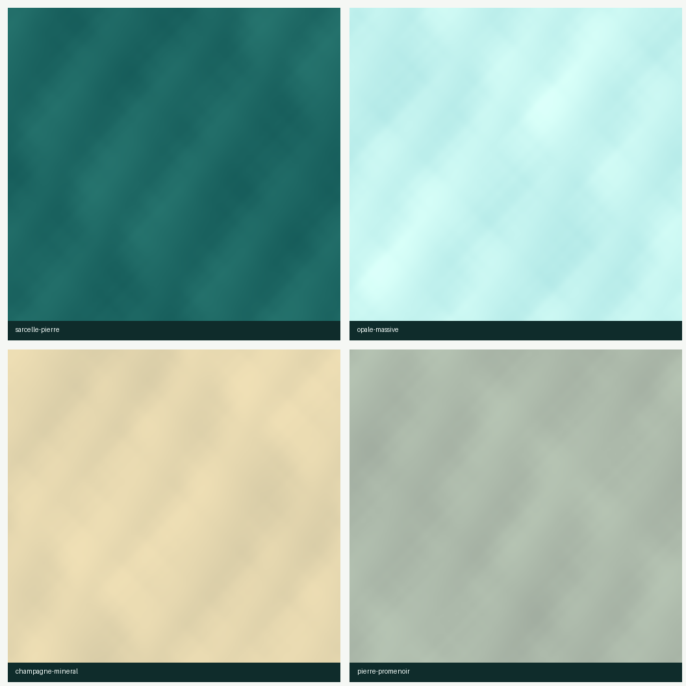

# Art Style & Asset Library

Kin City's architectural signature is **deep teal, mineral surfaces and restrained opaline crystal**. The goal is a coherent futuristic civic city, not a scene covered in fully transparent glass.

## Color tokens

| Use | Suggested color | Source |
| --- | --- | --- |
| Foundational teal | `#1E6864` | Crystal identity defined in v17+ |
| Dark mineral teal | `#123E3C` | Supporting tone |
| Opal crystal | `#C5F4F0` | Supporting highlight |
| Mineral champagne | `#E5D7AF` | Warm accent |

## Rendering approach

Most architectural crystal shapes are **opaque and faceted**, with selective `Glass` and `Neon` details where supported. Decorative parts generally avoid collision and unnecessary shadows. Visual construction profiles in `config/visual.json` are `LITE`, `STANDARD` and `SHOWCASE`; these are **build-time** settings. The game also contains client-side detail controls (`V`) that do not reconstruct structural geometry.

## Original 3D mesh designs

Eleven optional `.obj` assets are organized under:

- `assets/meshes-v23/` — columns, spires, rosettes, arches, chandeliers.
- `assets/meshes-v24/` — canopy, planter, console.
- `assets/meshes-v25/` — lattice, pediment, harbor crest.

A selection can be imported as a `MeshPart` in Roblox Studio and registered using `KinCity_Enregistrer_Mesh_Studio_v25.luau`. The asset library lives in `ServerStorage.KinCityAssetLibrary`; generator fallbacks use native Roblox geometry where a mesh has not been imported. The 11 IDs in `config/meshes.json` ship as `null` by default.

## PBR materials

Four original texture families are included in `assets/materials-v23/`: teal stone, solid opal, champagne mineral and promenade stone. Their `color`, `normal` and `roughness` files are source artwork; Studio import and appropriate Roblox MaterialVariant/SurfaceAppearance configuration are still required for final use.

`KinCity_Enregistrer_Materiau_Studio_v25.luau` assists with registration of imported materials. Do not assume the installer uploads textures or creates Roblox asset IDs automatically.

## Practical workflow

1. Run the v26 installer with the native-geometry fallback.
2. Open the generated Place and inspect scale, doors, navigation and lighting.
3. Import the optional meshes/textures in Studio and register them with the supplied scripts.
4. Rebuild the affected Place to propagate the reusable asset through the relevant generators.
5. Evaluate visuals and performance with the same camera positions before and after asset replacement.

Keep the navigable/collidable building structure independent from decorative meshes where appropriate. Do not merge a huge institution into one indivisible mesh just to reduce a raw object count.
