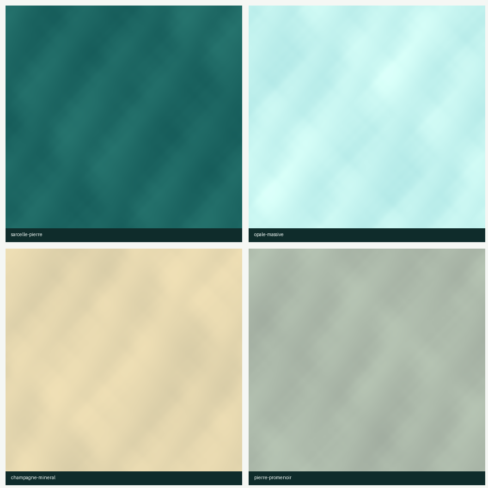

# Kin City — Project Wiki

**Kin City** is a modular Roblox 3D city centered on civic spaces, education, creativity, exploration, and community life. Its architectural identity combines **deep teal `#1E6864`** with faceted **opal crystal**. The project is designed as a future virtual interface for the kOA digital ecosystem, while the current build works as a standalone, locally interactive experience.

> **Current baseline: construction v26 (October 19, 2026).** The city and eight institution interiors can be generated separately. The released files have passed offline checks; gameplay, published teleportation, collision and device performance have **not** been verified in Roblox Studio or the published Roblox client.

## Start here

| I want to… | Page |
| --- | --- |
| Build the city in Roblox Studio | [Quick Start](Quick-Start) |
| Understand the separate city/interior design | [Architecture](Architecture) |
| Set up nine Roblox Places and real travel | [Places & Teleportation](Places-and-Teleportation) |
| Explore the city and its institutions | [Worlds & Institutions](Worlds-and-Institutions) |
| Find keyboard controls and interactions | [Controls & Interactions](Controls-and-Interactions) |
| Work on Luau, data, or releases | [Development & Builds](Development-and-Builds) |
| Import custom 3D meshes, textures, and sounds | [Art Style & Assets](Art-Style-and-Assets) / [Audio](Audio-and-Ambience) |
| Check installation errors | [Troubleshooting](Troubleshooting) |
| Read the current limitations | [Project Status & Roadmap](Project-Status-and-Roadmap) |
| Commencer en français | [Démarrage rapide — FR](Demarrage-Rapide-FR) |

## The world at a glance

- A **separate exterior city** with civic facades, neighborhoods, houses, markets, public spaces, an archipelago, trams, buses, ferries, NPCs, and exploration activities.
- **Eight large institution interiors**, each with its own build target, galleries, themed rooms, vertical extensions, and local interactions.
- **Code-generated architecture**, including doors, lighting, R15 citizens, artworks, native-mesh fallbacks, and interactive exhibits.
- **Optional artist-supplied content**: 11 original OBJ designs, PBR texture sets, and eight locally generated sound beds. No paid asset or invented Roblox asset ID is required for the basic build.
- **Explicit `WORLD_STUB` product mode**: services from kOA are **not connected**. Local activities work where implemented; service terminals show **“Fonctionnalité à venir”** rather than pretending to perform remote operations.

## Scope and honesty

This wiki describes **the v26 source repository**, not a finished public Roblox experience. `SPLIT_PREVIEW` lets a developer construct each scene independently; it does **not** teleport between unpublished Places. `LOCAL_UNIVERSE` is a fallback for local travel testing inside one Place and is **not** server-level separation. `MULTI_PLACE` requires real Place IDs and a published Roblox experience.

**License status:** the repository contains `LICENSE-DECISION.md`; no distribution license has been selected. Public access to source code does not automatically grant open-source reuse permissions. See [Contribution & Licensing](Contribution-and-Licensing).
