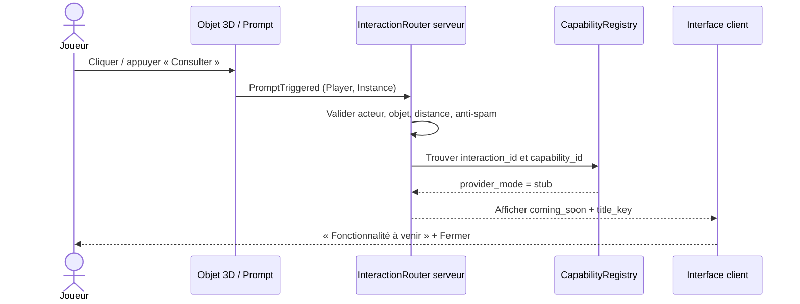

# InteractionRouter, CapabilityRegistry et fournisseur stub

## Diagramme séquentiel



## Contrat d'objet

`InteractionManifest` contient ID, building, anchor, capability, fournisseur autorisé, clés d'UI. La scène générée assigne `KinCityInteractionId` à un objet marqué `KinCityInteractive`. Les scripts ne doivent jamais traduire librement les noms de meubles vers des noms de services.

## Contrat de capacité

`CapabilityManifest` contient ID sémantique, propriétaire référencé (documentaire), mode fournisseur, statut et politique de contenu futur. Par exemple `konnected.catalog.browse`, `ethikos.consultation.list`, `smartvote.ballots.browse`. Ces noms ne sont **pas** des endpoints kOA existants.

## Contrat de réponse locale

```json
{
  "status": "coming_soon",
  "interaction_id": "ethikos.justice_palace.terminal_01",
  "capability_id": "ethikos.consultation.list",
  "title_key": "title.consultations",
  "message_key": "ui.coming_soon",
  "performed_operation": false
}
```

En `WORLD_STUB`, la réponse est calculée localement, sans requête HTTP, sans stockage de vote, sans crédits inventés. `performed_operation` est toujours `false` pour une capacité métier en attente.

## Sécurité même en stub

L'événement doit être lié à l'Instance active, au joueur présent, à la position/distance, au délai anti-spam et à une seule interaction par activation. Un client qui modifie `capability_id` dans son UI n'obtient aucun droit supplémentaire. Limiter les ouvertures répétées pour éviter les boucles d'UI et déni de service local.

## Évolution vers un vrai fournisseur

Le routeur et les ID ne changent pas. Seul `ProviderRouter` résout une capacité explicitement activée vers un adaptateur approuvé. Le Gateway futur émet `unavailable`, `denied`, `success` ou d'autres états réels. La réponse stub ne doit pas masquer une panne d'une fonctionnalité active : `coming_soon` n'est pas un traitement d'exception réseau.

## Tests

Objet connu, objet inconnu, ID en double, modèle stream out, joueur hors portée, ouverture/fermeture répétée, touche tactile/manette, titre manquant, capacité introuvable, HTTP accidentel interdit, absence de fausse mutation.
