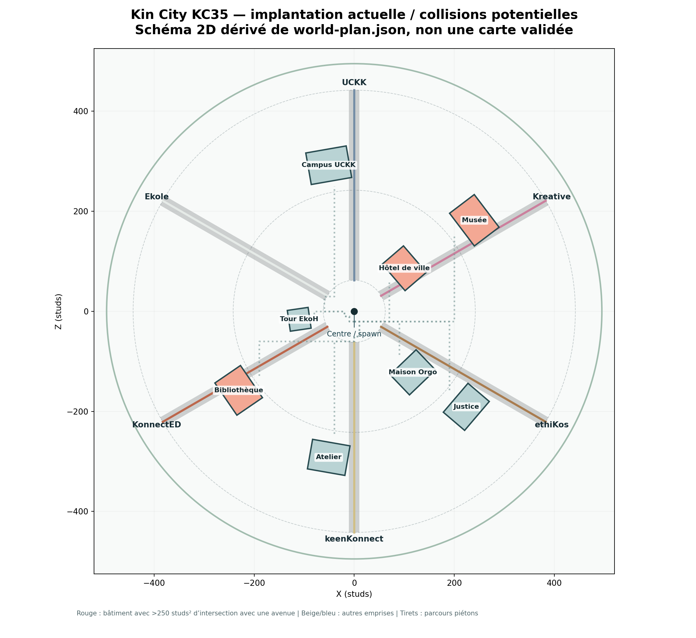

# 01 — Vision, plan directeur, composition urbaine

## 1. Intention et référentiel artistique

Kin City est une **ville du savoir habitée**, d'inspiration Art déco, civique et chaleureuse : une composition urbaine qui se comprend à pied. **V30 est la référence qualitative à comparer**, non une base technique à réinstaller. On conserve de KC35 la source déterministe, la séparation future des Places, les mécanismes, les identifiants, les neuf contributions et le Package central des 121 modèles.

Exigence : chaque volume a une justification par rapport au tracé de la rue, au relief, à un parvis et aux autres façades. On évite les monuments posés au milieu des voies, l'empilement arbitraire de volumes et les enseignes qui dominent les bâtiments.

## 2. Trois échelles complémentaires

**Métropole / 1 000 studs :** lecture des six directions et des huit institutions. **Quartier / 100–300 studs :** avenues, perspectives, carrefours, jardins et espaces de rencontre. **Parcelle / 10–100 studs :** trottoirs, limites de propriété, seuils, marches, alignements d'arbres et panneaux intégrés.

Le plan urbain doit répondre à trois questions sans une UI énorme : Où suis-je ? Que puis-je voir au bout de cette voie ? Comment rejoindre une entrée sans franchir une pelouse inaccessible ?

## 3. Topologie actuelle KC35 — observation du code, pas validation esthétique

**Repère** : X horizontal, Y vertical, Z horizontal, `Y=0` sol public logique. La ville utilise un disque nominal de rayon **495 studs**. Le catalogue mentionne « trois anneaux » et `radius_units=450`, mais ceux-ci sont **des intentions de topologie**, pas la preuve d'un anneau routier physiquement continu. Le générateur `KoaliUrbanism.avenue` construit **six branches radiales** de `r ≈ 62` à `442`, par 19 dalles de 20 studs, **19 studs de largeur**. Il existe en plus huit parcours `pedestrian_paths` avec `width_studs=6` ; ceux-ci ne doivent pas être assimilés à une avenue carrossable.

Le secteur **central** est un noyau civique transverse, en plus de six rayons géographiques. Le mécanisme « heure sur cadran » qui sert à distribuer les directions est une donnée de composition **interne uniquement**, jamais une étiquette publique.

| Axe actuel | Direction X/Z | Identité de conception (non une pancarte) |
|---|---|---|
| keenKonnect | `[0, -1]` | Innovation / ateliers |
| ethiKos | `[+0,866, -0,5]` | Justice / discussion |
| Kreative | `[+0,866, +0,5]` | Arts / mémoire |
| UCKK | `[0, +1]` | Campus / savoir |
| Ekole | `[-0,866, +0,5]` | Lecture / découverte |
| KonnectED | `[-0,866, -0,5]` | Apprentissage / bibliothèque |

**Ne pas confondre** ce diagramme KC35 avec l'ancien schéma illustratif `07-construction/specification-spatiale.md` (centres différents). **La base effective courante** est `build/world-plan.json`, SHA canonique `5941cd6ecd89ea806cd5b815fcc128b1abef1cff77f77d670dbe01c7f487039a`.

## 4. Implantation actuelle des huit institutions (KC35)

La position et la rotation ci-dessous sont tirées du **plan logique actuel**, pas des valeurs cibles proposées. Les empreintes sont **largeur X × profondeur Z**, tournées par `yaw_degrees`.

| Institution | `building_id` | Centre `[X,0,Z]` | Empreinte | Yaw |
|---|---|---|---|---|
| Hôtel de ville | `central.city_hall` | `[100,0,86]` | `70×56` | `49,304°` |
| Observatoire EkoH | `central.ekoh_tower` | `[-110,0,-16]` | `42×42` | `-98,276°` |
| Grande Bibliothèque | `konnected.library` | `[-231,0,-158]` | `78×62` | `-124,371°` |
| Université UCKK | `konnected.university` | `[-51,0,292]` | `82×64` | `-9,907°` |
| Agora Korum | `ethikos.justice_palace` | `[224,0,-191]` | `76×56` | `130,454°` |
| Atelier Konstruct | `keenkonnect.innovation_lab` | `[-51,0,-292]` | `76×60` | `-170,093°` |
| Galerie Konservation | `kreative.museum` | `[240,0,182]` | `82×62` | `52,826°` |
| Maison Orgo | `orgo.admin_center` | `[117,0,-122]` | `72×56` | `136,198°` |

Ce tableau est un **état actuel**, volontairement non édité. Le repositionnement à venir exige un plan cible indépendant, approuvé et versionné.



## 5. Plan cible : hiérarchie des espaces, pas inversion de priorité

```text
(0) Limite de l'île, eau et zones naturelles protégées
            ↓
(1) Réseau public : centre piéton, voies majeures, intersections et traversées
            ↓
(2) Îlots constructibles et parcelles libres hors emprise de voirie
            ↓
(3) Parvis / recul / seuils visibles depuis les chemins
            ↓
(4) Volumes construits positionnés sur les parcelles approuvées
            ↓
(5) Façades, éléments Art déco, vitrines et seuils
            ↓
(6) Mobilier, arbres, lumière et signalétique physique
            ↓
(7) Interactions, portes, avatars, événements
```

Les futurs anneaux doivent être spécifiés par centre, rayon, largeur, type et priorité, puis **validés au même titre que les axes radiaux**. Ne pas dessiner des anneaux de décoration qui se superposent à des bâtiments sans vérifier leur gabarit.

## 6. Principes de silhouette et d'intégration

- **Nœud central** : place perméable, dégagée, lisible dès l'apparition, sans structure surplombant le spawn ni confusion « centre = immeuble ».
- **Avenues** : sections lisibles, bords et trottoirs cohérents. Les bâtiments les bordent, ne les traversent pas.
- **Carrefours** : ouverture de visibilité et courbure/raccord des bordures ; pas de chevauchement d'une seconde dalle de voirie.
- **Façades** : au moins une entrée principale lisible depuis l'approche piétonne ; pente, marche et parvis reliés.
- **Landschaft/pelouse** : surfaces végétales continues **entre** les parcelles et les chemins, non sous des façades qui surgissent au hasard.
- **Échelle** : totems rares, plafonnés ; une seule enseigne principale par institution, portée physiquement.

## 7. État de B07

Galerie Konservation : **porte extérieure volontairement barrée**, ancre et `door_id` conservés pour compatibilité. Écran de broadcast près du musée et visible depuis l'approche publique. Le média doit être présenté honnêtement comme panneau de diffusion, pas comme lecture YouTube native dans Roblox (voir chapitre signalétique). La clôture ne doit jamais bloquer les voies principales.

## 8. Livrables de conception attendus avant nouveaux scripts

Un plan aérien général coté, un plan par axe, un registre de parcelles, une emprise par édifice, des tracés d'accès, un plan des surfaces du sol, un plan de visibilité des enseignes, un plan d'éclairage, des photos V30/V35 depuis les mêmes caméras, et **la liste des conflits résolus**. Aucun générateur ne devient propriétaire d'une parcelle par la simple exécution de sa fonction `.make()`.
