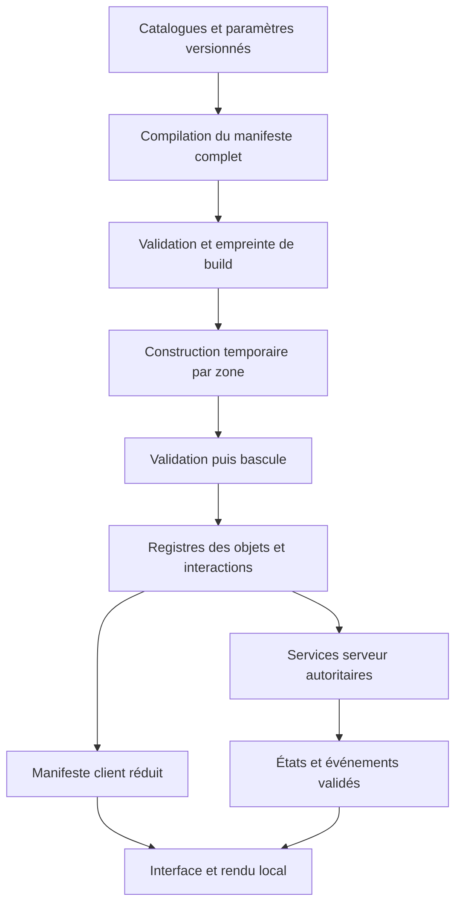

# Kin City v17 — Audit approfondi et plan d’optimisation

**Date : 19 octobre 2026.** Analyse des quatre fichiers fournis, de l’archive de construction et de la documentation officielle Roblox consultée à cette date.

## 1. Décision proposée

**Conserver le projet et son identité artistique, puis consolider sa chaîne de construction et son runtime avant de poursuivre l’expansion.** La v17 possède de bons fondements : génération déterministe d’un noyau de données, IDs stables, séparation serveur/client, interactions locales réelles, garde-fous côté serveur, kit artistique réutilisable et mode `WORLD_STUB` explicite.

Son principal problème est l’écart croissant entre trois représentations du monde : le catalogue validé, les ajouts procéduraux dans le code, et la scène conservée dans Studio. Les tests protègent principalement la première. L’optimisation doit réunifier ces représentations, puis réduire les coûts réellement mesurés.

« Optimal » doit signifier : fiable à installer et mettre à jour, agréable sur les appareils retenus, cohérent en multijoueur, maintenable, et suffisamment économique en mémoire, rendu et réplication. Il n’existe pas de réglage optimal universel indépendant du matériel, du nombre de joueurs et du niveau de détail attendu.

**Ordre recommandé : intégrité des builds → fiabilité des déplacements → mesure → optimisation serveur/client → géométrie et streaming → finition de l’expérience.** Une conversion massive en meshes, une réécriture complète ou une division systématique en Places ne sont pas justifiées avant ces étapes.

## 2. Périmètre et preuves

### Ce qui a été vérifié

| Élément | Résultat |
|---|---|
| Archive | 269 fichiers, 4 104 079 octets décompressés selon l’inventaire ZIP |
| Code Luau | 114 fichiers : 80 serveur, 16 client, 18 partagés |
| Volume de code | 13 477 lignes, dont les modules générés ; 601 099 octets sous `src/` |
| Installateur livré | 609 115 octets ; identique à la version correspondante de l’archive |
| Tests Python | **13 tests réussis** après installation de `jsonschema` dans un répertoire temporaire |
| Validation catalogue | 0 erreur ; 9 avertissements liés aux PlaceIds non publiés |
| Validation spatiale | 0 erreur pour le périmètre du catalogue |
| Reproductibilité | Les tests régénèrent les modules et l’installateur sans différence avec les fichiers correspondants du ZIP |
| Interactions serveur | 18 abonnements à `PromptTriggered` trouvés dans les sources |
| Interface | 15 créations de `ScreenGui` et 5 abonnements à `RenderStepped` |
| Parcours globaux | 22 occurrences textuelles de `GetDescendants()` ; ce n’est pas une mesure de leur fréquence |
| Réseau métier | Aucune occurrence de `HttpService`, `DataStoreService` ou `OnServerEvent` dans les fichiers Luau examinés |

Les sources ont été inventoriées dans leur ensemble. La lecture détaillée a porté sur les chemins critiques d’installation, construction, réhydratation, déplacements, transports, routage, activités, PNJ, interface, export et validation, ainsi que sur les générateurs représentatifs et leurs appels. Les comptages textuels servent à orienter l’audit : ils ne sont ni un profil d’exécution, ni une preuve d’absence de défaut dans chaque branche de chaque module.

### Ce qui n’a pas été exécuté

Roblox Studio, le client Roblox publié, l’analyseur Luau et Rojo ne sont pas disponibles dans cet environnement. Aucun FPS, nombre réel d’Instances générées, temps de build Roblox, coût GPU, mémoire client ou débit réseau n’a donc été mesuré. Les collisions, l’apparence, le streaming et les téléportations restent à qualifier dans le moteur. L’audit ne prétend pas certifier une absence totale de bugs.

Les pièces jointes originales n’ont pas été modifiées. Les exports de vérification ont été exécutés dans une copie de travail et comparés aux octets du ZIP.

### Lecture des niveaux de preuve

- **Vérifié** : propriété du code, comparaison de fichiers ou résultat hors moteur reproduit.
- **Risque établi par le code** : chemin problématique identifié ; occurrence et gravité en jeu à reproduire dans Studio.
- **À mesurer** : coût probable ou choix d’architecture dont le bénéfice doit être confirmé.
- **Proposé** : cible recommandée, pas fonctionnalité déjà présente.

## 3. Problèmes à traiter en premier

| ID | Priorité | Constat | Preuve | Effort relatif |
|---|---|---|---|---|
| F01 | P0 | Remplacement destructif avant validation | Vérifié | Moyen |
| F02 | P0 | Une scène incomplète peut porter une signature de build valide | Risque établi | Faible à moyen |
| F03 | P0 | Régénération d’intérieur sans réinstallation des interactions canoniques | Risque établi | Moyen |
| F04 | P1 | Signature de cache incomplète | Reproduit hors moteur | Moyen |
| F05 | P1 | Streaming non garanti par l’installation directe | Code + documentation | Faible |
| F06 | P1 | Déplacements asynchrones sans verrou commun ni revalidation complète | Risque établi | Moyen |
| F07 | P1 | Transports avec états et nettoyages fragmentés | Risque établi | Moyen |
| F08 | P1 | Catalogue spatial incomplet par rapport au monde construit | Vérifié | Élevé, progressif |
| F09 | P1 | Job CI sans installation de dépendances | Vérifié | Faible |
| F10 | P1 | Plan JSON de livraison périmé | Reproduit hors moteur | Faible |
| F11 | P1 | Chevauchement de contrôles d’interface | Déduit des coordonnées exactes | Faible à moyen |
| F12 | P1 | Absence de référence de performance mesurée | Vérifié dans les livrables examinés | Moyen |

P0 signifie « avant de s’appuyer sur ce mécanisme de mise à jour ou de régénération ». Cela ne signifie pas qu’une installation neuve échoue systématiquement. P1 signifie « avant qualification de la prochaine livraison ». Les efforts sont relatifs ; aucune estimation calendaire ne remplace un découpage après correction des premiers défauts.

## 4. Installation, génération et cohérence de version

### F01 — Installation destructive

**Sources :** `tools/make_studio_installer.py`, `WorldBuilder.build()` dans `src/server/WorldBuilder.luau`.

L’installateur détruit `KinCityShared`, `KinCityRuntime` et `KinCityUI` avant de vérifier la construction suivante. Le générateur supprime ensuite `KinCityGenerated` avant de fabriquer le nouveau monde. Le `pcall` affiche une erreur, mais ne restaure pas la version précédente. Une erreur de module ou de géométrie peut laisser un projet sans son ancienne scène fonctionnelle.

**Correction :** ajouter une prévalidation du mode Édition et des entrées, préparer les modules et la scène dans un espace temporaire, vérifier le résultat, puis effectuer la bascule. Conserver l’ancienne version jusqu’au succès. Le code actuel résout des chemins fixes dans `ReplicatedStorage` : une vraie préparation isolée nécessite de passer un contexte de build aux générateurs, ou d’employer un mécanisme de sauvegarde/restauration explicite. Ajouter simplement un dossier temporaire sans corriger ces dépendances serait insuffisant.

**Acceptation :** provoquer une erreur à chacune des phases ; la scène précédente reste utilisable, les scripts précédents sont restaurés et aucun dossier partiellement actif n’est laissé en place.

### F02 — Signature posée trop tôt

**Source :** `WorldBuilder.build()` attribue `KinCompilerSha` et `KinWorldBuilderRevision` au début, avant `CityGenerator.make()` et la construction des intérieurs. `rehydrate()` ne vérifie pas un statut de complétude.

Si une génération échoue après ces affectations, un lancement ultérieur avec `build(true)` peut accepter le dossier incomplet comme une scène valide. Il s’agit d’un défaut logique distinct de la perte de l’ancienne scène.

**Correction :** écrire `BuildState = Building` au départ, puis `Ready` seulement après vérification des ancres, portes, modèles attendus et interactions. Refuser toute réutilisation sans état `Ready` et manifeste complet. En cas d’erreur, détruire seulement la construction temporaire.

**Acceptation :** une scène interrompue ne peut jamais être réhydratée comme prête.

### F03 — Régénération partielle et interactions perdues

**Sources :** `WorldEditor.regenerateInterior()`, `InteriorGenerator.make()`, `PropGenerator.make()`, `WorldBuilder.build()`.

La régénération partielle appelle uniquement le générateur d’intérieur. Or les prompts des interactions canoniques sont ajoutés ensuite par `WorldBuilder`, sur les meubles identifiés par leur ancre. Ils ne sont pas recréés par `InteriorGenerator`. L’ancienne empreinte du monde reste présente et la réhydratation ne recrée pas les prompts absents.

**Correction :** extraire la liaison des interactions en fonction partagée `bindPlace(placeKey, registry)` et l’appeler après toute génération, complète ou partielle. Revalider le manifeste de la zone. À défaut, invalider explicitement le monde pour forcer une reconstruction complète au prochain démarrage.

**Acceptation :** régénérer séparément chacun des huit intérieurs ; retrouver les mêmes IDs, la même interaction canonique et les activités locales attendues. En mode Play, interdire la régénération tant qu’un cycle de détachement/rattachement des services n’existe pas.

### F04 — Empreinte de cache incomplète

**Sources :** `tools/compile_plan.py`, `tools/export_roblox.py`, `WorldBuilder.rehydrate()`.

L’empreinte canonique couvre les données assemblées par `compile_plan()`, mais pas `crystal_theme.json`, le contenu des réglages visuels, le mode runtime ni le code des générateurs. La révision ajoute le nom du profil, pas ses paramètres.

**Expériences reproduites dans des copies temporaires :** changer l’opale du thème, augmenter `central_jalons` dans `STANDARD`, ou modifier le mode runtime ne change pas l’empreinte du plan. Modifier uniquement le profil de `STANDARD` à `LITE` est, lui, pris en compte par la révision du générateur.

Une réinstallation complète reconstruit effectivement la scène ; ce défaut concerne surtout les modifications synchronisées ou éditées suivies d’une réutilisation de la scène préexistante.

**Correction :** générer une empreinte de construction séparée du hash du plan : données, paramètres effectifs, sources pertinentes et version de l’outillage. Ajouter au contexte de validation le mode de routage et la Place courante. Prévoir éventuellement une empreinte par zone, après stabilisation du système global.

**Acceptation :** chaque changement qui affecte la scène invalide la bonne partie ; un changement de documentation seul ne la reconstruit pas.

### F05 — Activation du streaming non garantie

**Sources :** fin de l’installateur, `default.project.json`, documentation Roblox [R1].

Rojo déclare bien `StreamingEnabled: true`. L’installateur direct tente de l’activer dans un `pcall` dont le résultat est ignoré. Roblox documente cette propriété comme non configurable depuis un script. Le succès de l’installation ne constitue donc pas une preuve de streaming actif ; les nouveaux projets peuvent déjà l’avoir activé par défaut.

**Correction :** faire de ce réglage une propriété Studio/projet explicitement vérifiée. Lire et rapporter son état réel, avec une procédure de correction si nécessaire. Traiter de même les autres paramètres de streaming retenus pour la livraison.

**Acceptation :** tester l’installation dans une Place avec streaming désactivé et dans une Place où il est actif ; l’état indiqué doit être exact et la qualification doit refuser le mauvais réglage.

### F09–F10 — Chaîne de livraison à unifier

**Sources :** `.github/workflows/code-checks.yml`, `.github/workflows/docs-validation.yml`, `tools/export_roblox.py`, `build/world-plan.json`.

Le job `code-checks` lance les validations sans installer `requirements-dev.txt`. L’autre workflow le fait, mais ses dépendances ne sont pas partagées avec le premier job. Ce défaut est à corriger même si certains environnements possèdent déjà la bibliothèque.

Le plan JSON livré porte le hash `30b74b3f…29d59`, tandis que le plan recompilé et `WorldPlan.luau` correspondent à `5592890d…3c610`. Les différences de premier niveau sont **`styles` et `canonical_sha256`**. Aucun changement de géométrie n’est démontré par cette comparaison. L’export Luau ne remet pas automatiquement à jour le JSON de `build/`.

**Correction :** une commande de release produit le plan JSON, les modules, l’installateur principal, ses éventuelles copies de distribution et un manifeste de hashes. La CI installe les dépendances, exécute les contrôles, puis refuse toute divergence de tous ces livrables. Retirer les installateurs v10/v15 du chemin de livraison courant ou les classer clairement comme archives.

**Acceptation :** depuis un environnement Python vierge, une commande produit une release reproductible. Le nom v17, la révision, le hash du plan et les hashes des fichiers concordent. Conserver les anciennes releases séparément pour le retour arrière.

## 5. Déplacements, transports et multijoueur

### F06 — Courses entre déplacements asynchrones

**Source :** `PlayerTravel.move()`, `tryLift()`, `tryDoor()` et `IntermodalTransfers`.

`RequestStreamAroundAsync()` peut suspendre l’exécution jusqu’à plusieurs secondes. `move()` et `tryLift()` reprennent ensuite sans vérifier complètement que le personnage capturé est toujours le personnage actif et vivant. Le délai de porte est de 1,6 seconde, alors que le préchargement peut attendre 4 secondes. Un limiteur de fréquence ne garantit donc pas qu’un seul déplacement soit en cours.

`IntermodalTransfers` vérifie déjà l’identité du personnage après l’attente : c’est une protection utile à généraliser. Elle ne remplace pas un verrou partagé entre tous les modes de transport.

**Correction :** introduire une session de déplacement par joueur avec identifiant de requête, personnage concerné et états `Idle`, `Loading`, `Moving`, `Riding`. Après chaque attente : vérifier joueur, personnage, santé, session et destination. Une ancienne requête ne peut plus déplacer le personnage ni écraser `KinZone`. En cas d’échec de chargement, présenter un retour clair et conserver une position sûre.

**Acceptation :** mort, respawn, déconnexion, deux activations rapides, ascenseur pendant un trajet et échec de préchargement ne produisent ni déplacement tardif ni état de zone incohérent.

### F07 — États de transport et annulation

**Sources :** `Tramways`, `IslandFerries`, `BoulevardBuses`, leurs HUD.

Les véhicules disposent déjà de nettoyages au départ du joueur et à la destruction du monde. Les bus et ferries vérifient `root.Anchored` à l’embarquement ; les bus consultent aussi certains attributs d’occupation. Ces mécanismes sont utiles, mais chaque système garde son propre registre. Le tram ne possède pas le même contrôle d’ancrage initial et les portes/ascenseurs ne consultent pas une occupation commune.

De plus, `abort()` du ferry et `stopTrip()` du bus libèrent les passagers sans envoyer systématiquement `cancel` au HUD. Les clients savent recevoir `cancel`, mais il manque sur certains chemins. Une interface de trajet peut rester affichée, notamment après une interruption qui ne détruit pas le `PlayerGui`. Une sortie normale de boucle du tram peut aussi être présentée comme une arrivée, car `pcall` indique seulement l’absence d’exception.

**Correction :** partager la gestion des occupants et la capture/restauration des propriétés du personnage. Définir explicitement `completed`, `cancelled`, `failed`, `respawned` et `world_destroyed`. Garantir un seul événement terminal pour chaque trajet et libérer tous les verrous, même en cas d’erreur.

**Acceptation :** tests avec plusieurs passagers, départ anticipé, décès pendant embarquement et traversée, changement de personnage, destruction du véhicule et destruction du monde ; aucun personnage durablement ancré et aucun HUD bloqué.

### F13 — Déplacement visuel des véhicules

Les trams, ferries et bus déplacent côté serveur le modèle et chaque personnage par `PivotTo`, avec des attentes nominales de 0,08, 0,075 et 0,07 seconde. Cela correspond à environ 12,5 à 14,3 mises à jour programmées par seconde, pas à une cadence réelle garantie ni à une mesure du réseau.

**À mesurer :** saccades, réplication et charge avec plusieurs trajets simultanés. Comparer une simulation serveur sobre avec interpolation visuelle côté client. Le serveur doit rester autoritaire sur l’embarquement, la route, l’occupation et l’arrivée. Le déplacement physique du joueur doit être traité séparément du simple lissage du décor ; ne pas donner au client l’autorité sur sa destination.

Le pooling de véhicules n’est pertinent que si les pics de création/destruction sont effectivement dominants. Une flotte inactive conservée inutilement peut augmenter la mémoire.

## 6. Catalogue spatial et architecture de données

### F08 — Le plan testé ne décrit pas toute la scène

Le plan canonique contient neuf lieux, huit structures principales, seize portes, huit interactions métier et vingt-quatre pièces. Cela **ne signifie pas** que le jeu n’a que huit interactions : de nombreuses activités physiques sont définies dans les modules supplémentaires.

`InteriorWings.expand()` ajoute trois pièces à chaque institution après compilation. Les seuls ajouts de ce module portent déjà le nombre de pièces traitées par la boucle d’intérieur de 24 à 48. `VerticalArchitecture`, `SkyPavilions` et `InstitutionDiscoveryWings` ajoutent encore de la géométrie et des espaces. Les extensions urbaines, marinas, quartiers, îles et stations sont également largement définies dans le code ou dans des tables partagées séparées.

Les bounds canoniques d’un intérieur sont de 110 × 100 studs et 22 studs de hauteur. Une aile latérale ajoutée s’étend à ±105 en X ; la galerie v16 atteint environ Z=192 ; les observatoires dépassent largement Y=22. Les tests des bounds canoniques ne couvrent donc pas leurs enveloppes réelles.

**Correction :** compiler un manifeste spatial complet qui inclut les extensions : ID, zone, transform, enveloppe, points d’accès, volume de collision, interaction, variante visuelle et provenance. Les générateurs consomment ce manifeste. Migrer progressivement, module par module, sans renommer les IDs existants.

**Acceptation :** chaque élément interactif et chaque construction praticable est représenté dans le manifeste ; les validations couvrent les accès, chevauchements non autorisés et connexions des extensions.

### F14 — Origines d’intérieurs dépendantes de l’ordre

`Spatial.origin()` calcule l’emplacement d’un intérieur à partir de son index dans `WorldPlan.places`, avec un pas de 260 × 240 studs. L’ajout d’une clé qui modifie l’ordre trié peut déplacer des intérieurs existants. La taille des extensions n’entre pas dans ce calcul.

**Correction :** attribuer une origine explicite et stable à chaque `place_key`, puis valider les enveloppes complètes, marges et distances. Ne pas conclure à une collision réelle seulement à partir des espacements : il faut calculer les volumes générés et les vérifier dans Studio.

### F15 — Empilement de couches architecturales

`FacadeGenerator` construit une façade de base, puis appelle `ArchitecturePlus`, `FacadeDetail`, `HeritageFacadesV16` et `CrystalFacades`. L’intérieur possède un empilement comparable. Ce schéma permet d’enrichir vite la ville, mais rend difficile l’attribution du coût et la suppression des éléments devenus redondants.

**Correction :** définir des responsabilités explicites : structure, collision, silhouette, habillage, détails proches et interaction. Un profil doit sélectionner des variantes cohérentes, pas seulement ajouter un décor supplémentaire. Comparer les couches activées/désactivées avec les mêmes cadrages.

**À vérifier visuellement :** doublons, surfaces presque superposées, excès de silhouettes et détails invisibles. Aucune capture n’étant fournie, leur présence à l’écran n’est pas affirmée ici.

### F16 — Données partagées et frontières de responsabilité

`WorldPlan.luau` représente environ 78 Ko de source et se trouve dans `ReplicatedStorage`. Ce volume seul n’est pas le problème principal actuel, mais toutes les données serveur n’ont pas besoin d’y être. Carte et guidage utilisent le plan complet pour un sous-ensemble d’informations.

**Correction progressive :** conserver côté serveur les recettes, enveloppes, références internes et règles de validation ; exporter côté client un `NavigationManifest` et les informations d’affichage nécessaires. Éviter un framework générique prématuré. Le partage actuel d’un petit manifeste reste raisonnable tant que son coût est mesuré et contrôlé.

## 7. Performance serveur et cycle de vie

### F17 — Un point d’entrée commun pour les interactions

Les 18 abonnements globaux à `PromptTriggered` ne prouvent pas, à eux seuls, un problème de performance : la plupart filtrent rapidement. Ils dispersent toutefois les règles de santé, distance, zone, occupation et limitation de fréquence. Le « routeur central » ne centralise actuellement qu’une partie du comportement.

**Correction :** un dispatcher unique valide l’intention et dirige vers des handlers spécialisés. Conserver ces handlers séparés : réunir les 18 modules en un gros fichier rendrait le système moins maintenable. Les types d’action et les IDs doivent être enregistrés et validés.

**Acceptation :** un prompt reconnu déclenche exactement un handler ; un prompt inconnu ou désactivé est rejeté ; chaque handler conserve ses propres règles métier locales.

### F18 — Indexation au lieu de scans répétés

`ResidentialLife` parcourt tous les descendants du monde à chaque bascule de lanternes. `WorldBuilder` reparcourt les descendants des intérieurs pour chaque interaction canonique. Ce dernier cas n’a actuellement que huit interactions : son coût est surtout un risque de croissance. Plusieurs autres modules indexent déjà leurs objets au démarrage, ce qui constitue une bonne base.

**Correction :** créer `lampsByQuarter`, `propsByAnchor`, `interactionsById`, `modelsByZone` pendant la génération ou l’enregistrement. Mettre à jour les index lors de l’ajout/retrait d’une zone. Utiliser des tags ou un registre explicite selon les besoins ; ni `CollectionService` ni un seul scan global ne sont obligatoires partout.

**Acceptation :** l’action d’une lanterne ne visite que les objets de son groupe ; la liaison d’interaction n’effectue plus une recherche complète dans l’intérieur.

### F19 — Nettoyage et redémarrage des services

La plupart des `start()` ajoutent des connexions sur les services globaux sans retourner une fonction de nettoyage. Quelques boucles et transports gèrent déjà leur arrêt. Le problème concerne surtout une reconstruction en Play ou un second démarrage des services, plutôt qu’un lancement normal unique.

**Correction :** chaque service retourne un contrôleur avec `Destroy()` : connexions, tâches, tweens, registres et états temporaires. Rendre le démarrage idempotent ou refuser clairement un second démarrage. Retirer les références aux modèles détruits et libérer les personnages avant de retirer une zone.

**Acceptation :** vingt cycles de chargement/retrait d’une zone ne multiplient ni callbacks, ni PNJ, ni réponses à une action. La mémoire doit revenir à un niveau stabilisé, sans exiger une restitution instantanée par le moteur.

### F20 — Population et animation

Les boucles prévoient 36 citoyens stylisés, jusqu’à 10 citoyens R15 centraux, jusqu’à 12 résidents R15 et 14 oiseaux. Les créations R15 peuvent échouer et sont déjà protégées ; ces nombres sont des demandes de génération, pas un comptage observé en jeu.

Les citoyens stylisés et oiseaux sont animés côté serveur. Les citoyens R15 centraux modifient certains `Motor6D.C0` environ toutes les 0,16 seconde. Les résidents marchent indépendamment de la présence de joueurs. Le streaming client ne constitue pas, à lui seul, un mécanisme d’endormissement des simulations serveur.

**Correction :** distinguer PNJ interactifs et foule décorative. Conserver côté serveur les positions et états nécessaires aux interactions ; déplacer les détails de mouvement purement visuels côté client. Réduire l’activité des zones éloignées de tous les joueurs, avec une marge pour éviter des activations incessantes. Employer une animation de rig adaptée plutôt que multiplier les mises à jour manuelles de joints quand cela améliore réellement le profil.

**Acceptation :** comparer population désactivée, décorative uniquement et complète ; mesurer CPU serveur, réseau et rendu. Vérifier le dialogue des PNJ après migration. Les optimisations d’avatars joueurs proposées par Roblox ne doivent pas être supposées compatibles avec les PNJ : la documentation SLIM consultée exclut notamment les NPCs de son mécanisme d’avatars [R6].

### F21 — Effets partagés et travail visuel

Phares, sculptures et expériences modifient des propriétés ou pivots côté serveur, parfois à chaque Heartbeat. `OutdoorAtmosphere` crée à lui seul 72 lumières de lucioles et 8 lumières d’anneaux ; leur visibilité et activation varient. Le kit v17 ajoute une lumière de héros centrale, mais ne réduit pas toutes les lumières héritées.

**Correction :** répliquer un état ou un début d’animation horodaté, puis animer localement les éléments sans conséquence physique. Pour une nouvelle arrivée dans une zone, restaurer l’état courant, pas seulement attendre l’événement suivant. Garder côté serveur toute collision mobile ou règle d’interaction réellement nécessaire.

**Acceptation :** deux clients voient une action cohérente ; un client qui arrive en cours d’animation obtient l’état correct ; la baisse de trafic est mesurée. Limiter aussi les activations concurrentes d’un même mécanisme, selon sa sémantique.

## 8. Géométrie, rendu et streaming

### F22 — Profils visuels encore partiels

`LITE`, `STANDARD` et `SHOWCASE` contrôlent les nouveaux ornements : facettes, verre de héros, prismes, mandalas et jalons. Le README précise correctement que le profil est global au build et ne détecte pas l’appareil. Les vitres résidentielles, les ornements anciens, la population et les effets ne deviennent pas automatiquement légers en mode `LITE`.

**Cible proposée :** deux axes distincts : une configuration de construction des assets et une qualité visuelle locale. La première définit les recettes ; la seconde adapte ombres, post-traitement, foule décorative et détails optionnels pour chaque client. Les sols, escaliers, portes et règles de jeu restent cohérents entre clients. Prévoir un choix manuel et, si l’adaptation automatique est ajoutée, une mesure temporelle avec hystérésis plutôt qu’une classification « mobile = faible ».

### F23 — Rôles explicites des pièces

`Factory.part()` active par défaut collision et ombre pour toutes les pièces. Certains helpers désactivent collision, toucher, requête et ombre ; d’autres ne désactivent que la collision.

**Correction :** introduire des recettes `structure`, `collision`, `decor`, `interaction` avec des propriétés intentionnelles. Un décor sans fonction physique peut désactiver `CanTouch` et `CanQuery` lorsque c’est approprié. Ne pas désactiver aveuglément les requêtes d’un objet nécessaire aux raycasts ou aux interactions. Conserver les ombres qui apportent la lecture du volume et réduire celles des petits détails.

### F24 — Meshes et matériaux : remplacement ciblé

De nombreuses petites pièces répétées, détails de mobilier, meneaux et ornements sont candidats à des meshes réutilisés. Mais un mesh complexe ou unique pour chaque objet n’est pas automatiquement meilleur : textures, triangles, collisions et fragmentation peuvent annuler le gain.

**Méthode :** identifier les ensembles les plus coûteux dans le rendu ; comparer la version actuelle et une version modulaire avec les mêmes cadrages. Réutiliser les mêmes assets, simplifier la collision, séparer la silhouette des détails proches. Conserver les matériaux natifs quand ils suffisent. Le PBR doit servir un besoin visuel précis et son budget mémoire doit être mesuré [R2, R5].

Éviter de fusionner tout un bâtiment ou toute la ville en un modèle indivisible uniquement pour réduire un compteur d’Instances. Cela peut dégrader le streaming, l’édition et les collisions.

### F25 — Transparence et éclairage

Le nouveau kit cristallin fait des choix raisonnables : majorité opaque, pas de collision, pas d’ombre décorative, verre limité. En revanche, les vitres et transparences héritées restent nombreuses. Un nombre de Parts seul ne mesure pas le coût GPU ; la taille à l’écran et les couches transparentes superposées comptent aussi.

**Correction :** conserver les accents opalins et identifier les transparences sans valeur visuelle. Tester la place centrale et les façades au coucher du soleil, de nuit et sous un angle où plusieurs vitrages se superposent. Évaluer chaque post-effet, la portée des lumières et les ombres. Préserver une version lisible sans bloom. Les recommandations officielles privilégient la maîtrise des transparences partielles [R5].

### F26 — Streaming et niveaux de détail par unités cohérentes

Aucun réglage explicite de `ModelStreamingMode` n’est présent dans les sources examinées. Ce n’est pas automatiquement un bug : le mode par défaut peut convenir à une partie des objets. En revanche, les véhicules ancrés, assemblages de mécanismes et grandes institutions méritent une politique explicite.

**Cible :** petits ensembles logiques, streaming partiel pour les grands bâtiments, atomicité lorsque le client a réellement besoin d’un ensemble complet, persistance exceptionnelle. Tester les mécanismes qui disparaissent puis reviennent. Les modifications locales peuvent être perdues après déchargement : un contrôleur visuel doit réappliquer l’état lors du retour [R1, R6].

La documentation actuelle propose des options de LOD/SLIM pour des modèles statiques éligibles. Leur adoption doit être vérifiée dans la version Studio employée et sur les assets du projet ; ne pas les appliquer sans distinction aux modèles animés.

### F27 — Intérieurs dans une Place ou plusieurs Places

Le mode `LOCAL_UNIVERSE` garde les institutions dans des poches physiques. C’est une base plausible pour préserver les visites continues. Le mode `MULTI_PLACE` existe et exige de vrais IDs publiés ; il ne faut pas l’activer seulement parce que le monde est grand.

**Décision proposée :** conserver le mode local pendant la consolidation et profiler les intérieurs. Séparer uniquement une institution, un événement ou un ensemble lourd dont les mesures justifient le coût supplémentaire de transition, de publication et d’exploitation. Le streaming ne réduit pas à zéro la mémoire serveur de tout le monde construit. Une architecture hybride peut venir ensuite, en respectant les mêmes IDs [R5].

Pour les vues panoramiques, tester le contenu visible depuis la caméra, pas seulement autour du personnage. `VistaCamera` déplace la caméra sans politique explicite de préchargement de ce point de vue. Si un foyer de streaming supplémentaire est nécessaire, il doit être temporaire et retiré à la fermeture.

## 9. Interface, navigation et qualité d’expérience

### F11 — Un chevauchement démontrable

`IslandPassportHud` place son panneau dans le rectangle horizontal `[largeur−201, largeur−17]`, et `IntermodalPanel` place le bouton GARE dans `[largeur−94, largeur−16]`. Les positions verticales se recoupent également. Avec leur géométrie actuelle et les mêmes insets, l’intersection est de **77 × 34 pixels**. Le bouton GARE a un ordre d’affichage supérieur au carnet.

Cela peut être corrigé sans attendre un profil GPU. D’autres panneaux sont indépendants et ont des tailles fixes ; une fenêtre de 310 × 410 pixels ne tient pas dans tous les formats disponibles, notamment en paysage mobile avec les marges nécessaires.

**Correction :** une coque d’interface commune avec zones réservées, dispositions automatiques, panneau principal exclusif, navigation Carte / Destinations / Carnet / Activités, et bandeau contextuel unique pour les transports. Conserver les modules fonctionnels, mais partager layout, thème et gestion du focus.

**Acceptation :** aucune intersection des contrôles permanents, aucune sortie d’écran et aucun conflit avec commandes mobiles dans les formats choisis ; test tactile, clavier et manette. Les émulations Studio servent au layout, les appareils réels aux performances [R5, R7].

### F28 — Mises à jour de HUD et unités

Les HUD ferry et bus reconstruisent leur texte à chaque `RenderStepped` pendant un trajet, alors que le compte à rebours affiche des secondes entières. `MapHud` et `RouteGuide` sont déjà limités à environ quatre actualisations par seconde : ils ne doivent pas être présentés comme des calculs lourds exécutés intégralement à chaque image.

**Correction :** ne réécrire le compte à rebours que si la seconde affichée ou l’état change ; suspendre les calculs sans valeur quand le panneau est fermé. Garder une animation par image seulement lorsqu’elle est perceptible et nécessaire.

`RouteGuide` affiche une distance en `m` calculée directement à partir de studs. Choisir une unité cohérente ou appliquer une conversion documentée ; corriger également les libellés d’arrivée pour les destinations supplémentaires.

### F29 — Accessibilité et surcharge d’information

Points positifs : boutons `Activated`, raccourcis clavier, prompts compatibles manette et fermeture du dialogue principal à la manette. Cela ne démontre pas une navigation complète au gamepad dans tous les écrans.

**À améliorer :** ordre de sélection manette, restauration du focus, fermeture unifiée, tailles de texte adaptées, absence d’information véhiculée seulement par couleur, option de mouvement réduit et contrôle du son. Les réponses locales simples peuvent utiliser un petit retour contextuel plutôt qu’un dialogue modal qui interrompt chaque geste.

Les compteurs de découverte sont par session ; l’interface doit le dire clairement. Une sauvegarde persistante ne fait pas partie des corrections indispensables et demanderait une décision produit distincte.

### F30 — Direction artistique et parcours de visite

Préserver #1E6864 et #C5F4F0. Le thème central est bien utilisé par les nouveaux cristaux, mais des palettes restent codées dans de nombreux modules et dans l’interface. Définir des tokens de surface, texte, accent, signalétique et matériaux, avec des variantes institutionnelles. Unifier n’implique pas de rendre chaque objet sarcelle.

Faire servir la densité à l’orientation : silhouette forte pour chaque institution, entrées reconnaissables, chemins lisibles, contraste entre espaces calmes et points d’intérêt. Privilégier quelques interactions locales compréhensibles et des parcours courts qui donnent envie de poursuivre. Les stubs métier restent honnêtes, mais il faut distinguer clairement « activité locale disponible » et « service futur » pour éviter une succession de déceptions.

Le jugement esthétique reste conditionnel : aucun rendu Studio ni visite filmée n’a été fourni. Comparer les mêmes vues avant/après est indispensable pour optimiser sans appauvrir l’identité.

## 10. Sécurité et robustesse des interactions

L’audit ne démontre pas d’appel kOA, de secret ni de RemoteEvent entrant arbitraire. `KinCityReply` sert aux réponses serveur. De nombreux handlers contrôlent la distance, l’appartenance au monde, la santé et la fréquence. Les arrivées multi-Place recoupent les données de porte avec le catalogue. Ces protections doivent être conservées.

Les ProximityPrompts restent une frontière à valider côté serveur : Roblox documente les possibilités de déclenchement et de modification de propriétés côté client [R4].

**Durcissements utiles, sans inventer une faille exploitée :**

1. Un validateur commun vérifie joueur, personnage vivant, hôte attendu, action connue et distance autorisée côté serveur.
2. Une règle commune d’occupation empêche les déplacements incompatibles.
3. Ajouter, si la charge le justifie, un budget global par joueur et un budget par objet partagé, en complément des cooldowns par action.
4. Distinguer bascule d’état et animation exclusive pour éviter la compétition de plusieurs visiteurs sur le même objet.
5. Pour la coopération, décider si le premier participant doit encore être vivant et présent près de sa console lorsque le second valide ; le code vérifie sa présence dans le jeu et l’existence du personnage, pas toute cette condition.
6. Tester les réponses d’erreur et annulations aussi sérieusement que le parcours normal.

Le mode `WORLD_STUB` reste une configuration du produit durable. Il n’est pas nécessaire d’ajouter un gateway ou un système de compte pour optimiser la ville.

## 11. Architecture cible minimale



Les briques nouvelles peuvent rester peu nombreuses : `BuildManifest`, `WorldRegistry`, `InteractionDispatcher`, `TravelSession` et un contrôleur de cycle de vie. Les modules artistiques restent spécialisés. Le but est de clarifier les contrats, pas de construire un framework de grande taille.

**Contrat de zone proposé :** identité stable, manifeste et empreinte, construction, validation, liaison des interactions, activation, désactivation et destruction. Une zone ne devient accessible qu’une fois ses fonctions minimales valides. Les détails optionnels peuvent arriver ensuite.

## 12. Mesures nécessaires pour décider objectivement

### Référence de départ

Conserver une version v17 figée et une version de chaque changement. Relever : build, appareil exact, version Roblox, résolution, qualité graphique, nombre de joueurs, durée, scénario et état du cache. Utiliser le MicroProfiler, les statistiques de rendu, mémoire et réseau, et des marqueurs pour les grandes phases du générateur [R2, R3].

| Situation | Pourquoi elle compte |
|---|---|
| Première arrivée | Initialisation, réplication, chargement des rigs et interface |
| Place centrale à midi puis de nuit | Densité, lumières, PNJ et transparence |
| Intérieur, aile, étage et observatoire | Empreintes complètes, streaming, navigation |
| Enchaînement des huit institutions | Stabilité des transitions et mémoire retenue |
| Bus, ferry, tram simultanés | Réplication et gestion des passagers |
| Activités simultanées | Pics d’animation et règles par objet |
| Panorama distant | Contenu chargé autour de la caméra |
| Mort, respawn, départ pendant une action | Nettoyage et reprise |
| Session de 30 minutes | Mémoire, ressources retenues et cohérence des états |

Tester d’abord un joueur, puis huit joueurs et enfin la capacité de serveur retenue. Huit est un palier d’essai proposé, pas la capacité finale attestée.

### Budgets proposés à calibrer

| Indicateur | Proposition initiale | Statut |
|---|---|---|
| Fluidité PC cible | Viser 60 FPS, soit 16,7 ms par image | Objectif, pas résultat |
| Fluidité appareil modeste cible | Viser 30 FPS, soit 33,3 ms par image | Objectif, pas résultat |
| Distribution des temps d’image | Relever P50, P95, P99 et pics ; viser P95 dans le budget du scénario | À calibrer sur appareils réels |
| Gel perceptible | Compter les images >100 ms et identifier leur cause | Seuil de suivi proposé |
| Temps d’entrée jouable | Mesurer du lancement jusqu’au contrôle effectif, P50/P95 | Seuil après première référence |
| Transition locale | Mesurer du prompt jusqu’au contrôle à destination | Séparer préchargement et déplacement |
| Mémoire | Relever maximum, stabilisation et tendance sur 30 minutes | Pas de plafond universel inventé |
| Réseau | Débit entrant/sortant et pics par scénario | Comparaison avec la référence |
| Charge serveur | Coût par système et stabilité selon le nombre de joueurs | À mesurer |
| Fiabilité | 0 blocage du personnage et 0 interaction manquante dans les parcours de qualification | Critère fonctionnel |

Éviter les moyennes seules : un jeu peut afficher une bonne moyenne et comporter des gels fréquents. Le nombre d’Instances, de triangles et de draw calls doit être suivi, mais aucun seuil arbitraire ne garantit à lui seul la fluidité.

### Expériences de suppression ciblée

Pour identifier les responsables, comparer une même visite avec : foule décorative désactivée ; R15 désactivés ; anciennes transparences simplifiées ; lumières d’ambiance limitées ; couches architecturales secondaires désactivées ; animations visuelles locales. Chaque expérience conserve les fonctions de navigation et une scène identique autant que possible.

Modifier une famille de coûts à la fois et retenir le changement seulement si son gain et sa perte visuelle sont acceptables. Ne pas multiplier les benchmarks une fois un risque concret résolu.

## 13. Tests à ajouter

Les 13 tests actuels sont utiles et doivent rester. Plusieurs portent sur les données ou la présence de chaînes dans les sources ; ils n’analysent pas le Luau et ne simulent pas Roblox.

| Niveau | Tests utiles supplémentaires |
|---|---|
| Python / compilation | Invalidation du hash ; schémas du thème et profils ; cohérence des artefacts ; manifeste complet ; IDs stables |
| Analyse Luau | Syntaxe et types avec définitions moteur appropriées ; `--!strict` seul n’est pas une preuve de validation |
| Studio, construction | Build complet, build interrompu, rollback, reconstruction répétée, régénération de chaque zone |
| Studio, interactions | Prompts attendus, IDs uniques lorsqu’ils doivent l’être, refus des actions invalides, même comportement après réhydratation |
| Studio multijoueur | Cooldowns partagés, transports concurrents, coopération, décès et déconnexion |
| Client publié | Téléportations multi-Place si activées, chargement réel, réseau dégradé, appareils cibles |
| UI | Petits écrans, paysage/portrait visé, manette, focus, fermeture, chevauchements |

Tester les invariants et les erreurs plausibles. Éviter de remplacer les contrôles actuels par une grande quantité de tests qui reproduisent simplement l’implémentation sans vérifier le comportement.

## 14. Feuille de route proposée

| Étape | Changements | Condition de sortie |
|---|---|---|
| **A — Livraison fiable** | Installation réversible, état Ready, signature complète, dépendances CI, artefacts cohérents, liaison après régénération | Une panne contrôlée ne détruit pas la version précédente ; tous les parcours gardent leurs interactions |
| **B — Runtime stable** | Session de déplacement, terminaison des transports, nettoyage des services, chevauchement UI corrigé | Aucun personnage bloqué, HUD orphelin ou callback multiplié dans les scénarios d’échec |
| **C — Référence mesurée** | Instrumentation, appareils cibles, scénarios et comparaison v17 | Coûts dominants identifiés et budgets documentés |
| **D — Réduction des coûts** | Indexation, animations locales pertinentes, activité des PNJ par zone, profils élargis, streaming qualifié | Gain mesuré avec mêmes parcours et fonctions préservées |
| **E — Consolidation artistique** | Manifeste spatial étendu, variantes d’assets, meshes ciblés, UI unifiée, parcours lisibles | Identité préservée, géométrie couverte et aucune régression fonctionnelle |
| **F — Expansion** | Nouveaux lieux ou découpage hybride justifiés par les budgets | Toute extension possède données, coût, interactions et qualification |

Les étapes peuvent se chevaucher sur des tâches indépendantes, mais l’optimisation lourde de géométrie doit s’appuyer sur les mesures. Chaque étape conserve une release identifiable pour revenir à la version précédente.

### À ne pas prioriser maintenant

- Ajouter encore des quartiers pour démontrer la richesse avant de qualifier ceux qui existent.
- Convertir toutes les primitives en meshes ou tous les matériaux en PBR.
- Passer automatiquement à neuf Places publiées pour éviter de profiler.
- Déplacer la validation ou les destinations sous autorité du client pour gagner du CPU.
- Rendre tous les modèles `Persistent` ou tout un intérieur `Atomic` par facilité.
- Introduire Parallel Luau, un ECS ou une nouvelle bibliothèque d’architecture sans coût dominant identifié.
- Supprimer les contrôles serveur, les tests ou l’identité visuelle sous prétexte d’optimiser.

## 15. Définition d’une prochaine version réellement qualifiée

La prochaine livraison est prête lorsqu’elle s’installe et se reconstruit sans perdre une version valide ; que le manifeste décrit les espaces construits ; que toutes les portes, activités et sorties fonctionnent après génération et réutilisation ; que les personnages sont toujours libérés après interruption ; que l’interface tient sur les appareils cibles ; et que les mesures documentées respectent les budgets retenus.

Le dossier de qualification doit indiquer ce qui a été testé, sur quel appareil, dans quel build et avec quel résultat. Il doit également conserver les limites connues. **Une validation Python réussie reste la barrière hors moteur ; la preuve Roblox est une seconde barrière distincte.**

## Annexe A — Vérifications reproductibles

Depuis le répertoire du projet, dans un environnement de développement isolé :

```bash
python -m pip install -r requirements-dev.txt
python tools/validate_catalog.py
python tools/validate_spatial.py
python -m unittest discover -s tests -v
python tools/export_roblox.py
python tools/make_studio_installer.py
```

Attention : les tests actuels régénèrent certains fichiers. Ils ont donc été exécutés ici dans une copie de travail. Une comparaison avec le ZIP après exécution n’a détecté aucune différence dans les fichiers présents dans l’archive.

L’essai d’invalidation a été effectué dans des copies temporaires de `catalog/`, `schemas/` et `config/`. À tour de rôle : changement de `brand.opal`, changement de `profiles.STANDARD.central_jalons`, changement de `runtime.mode`. `compile_plan(...)["canonical_sha256"]` est resté identique. Ce test ne prétend pas qu’un export `MULTI_PLACE` sans vrais PlaceIds soit autorisé : l’export possède bien une barrière spécifique sur les IDs.

| Fichier ou résultat | SHA-256 |
|---|---|
| ZIP fourni | `b683d2737bc9cfdb9420c704a8d61a496c449edcee6c0d255f1fbd4e04c44016` |
| Installateur fourni | `b36f6090aca1236e624259b8da5926624b3928578136343d1f978595c5fadede` |
| Plan JSON archivé, empreinte interne | `30b74b3f5d2377bb857ef13c3bb20f3bd90edb052dd49f8246662b7c66029d59` |
| Plan recompilé, empreinte interne | `5592890decf83ddaba51c444466db055637c41b9f288ce512363af3812f3c610` |

## Annexe B — Documentation primaire consultée

Les constats sur Kin City proviennent des fichiers joints. Les recommandations moteur sont recoupées avec les sources officielles suivantes, consultées le 19 octobre 2026. Les réglages évolutifs doivent être vérifiés dans la version Studio de production.

- **[R1]** Roblox, [Instance streaming](https://create.roblox.com/docs/workspace/streaming) — configuration, modèles, chargement et retour des instances.
- **[R2]** Roblox, [Improve performance](https://create.roblox.com/docs/performance-optimization/improve) — CPU, rendu, mémoire, physique et réplication.
- **[R3]** Roblox, [Identify performance issues](https://create.roblox.com/docs/performance-optimization/identify) — outils de mesure et diagnostic.
- **[R4]** Roblox, [Securing the client-server boundary](https://create.roblox.com/docs/scripting/security/client-server-boundary) — validation des intentions et ProximityPrompts.
- **[R5]** Roblox, [Design for performance](https://create.roblox.com/docs/performance-optimization/design) — appareils cibles, matériaux, transparence, scripts et découpage.
- **[R6]** Roblox, [Streaming techniques and conversion](https://create.roblox.com/docs/workspace/streaming/techniques) — regroupement des modèles, atomicité et limites des mécanismes de LOD.
- **[R7]** Roblox, [Studio testing modes](https://create.roblox.com/docs/studio/testing-modes) — tests client/serveur et émulation.

**Livrable de cet audit :** ce rapport uniquement. Aucun correctif de production, publication, connexion kOA ou mesure Roblox n’a été réalisé.
